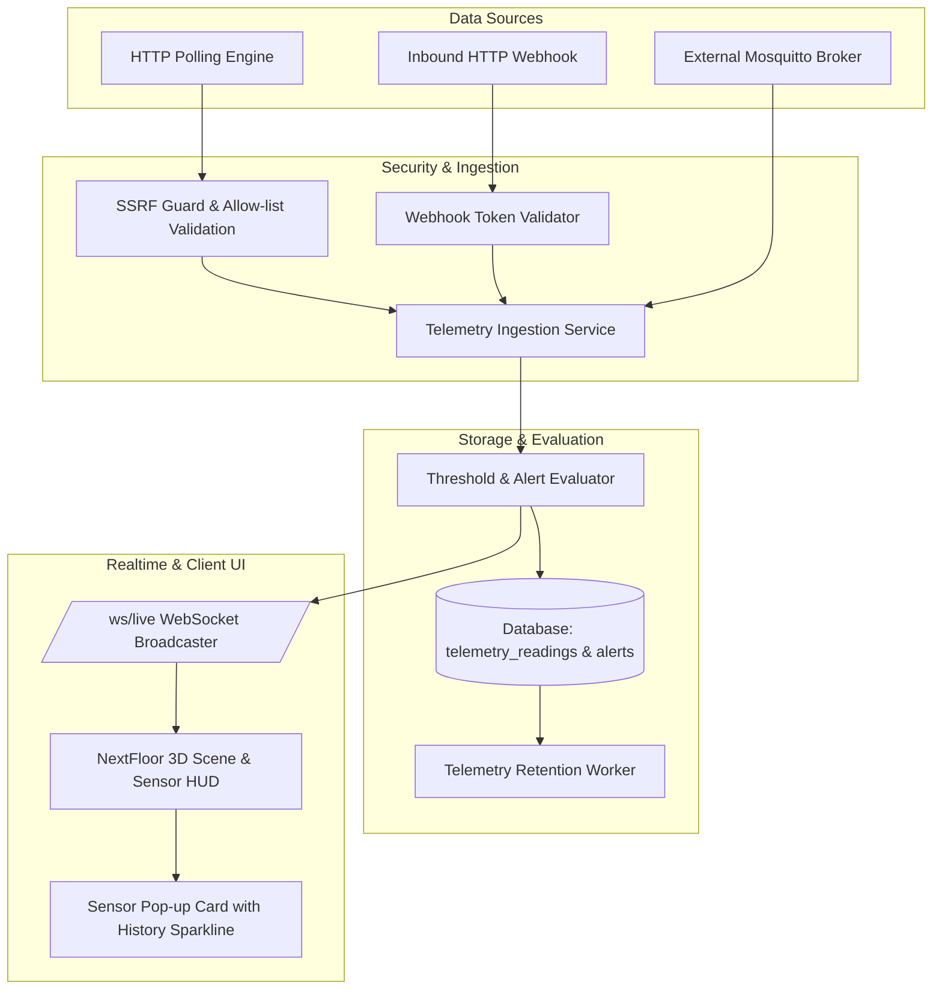

# Phase 3 Plan: Devices, Sensors & Telemetry Pipeline

**Document Version:** 1.0.0  
**Date:** 2026-11-10  
**Phase:** 3 — Devices, Sensors, Ingestion, Live Telemetry & Threshold Alerts  
**Engine Base:** NextFloor (MIT) with Server_Monits Backend

---

## 1. Overview & Ingestion Pipeline Architecture

Phase 3 introduces end-to-end data acquisition, real-time ingestion, threshold evaluation, and visualization for environmental monitoring (thermohygrometers, airflow, power, and environmental sensors):



---

## 2. API Endpoints

### 2.1 Sensors Management (`/api/v1/sensors`)
- `GET /api/v1/sensors`: List all registered sensors with current reading, status, and attached room/object.
- `POST /api/v1/sensors`: Register new sensor or link discovered sensor to a placed object on the floor plan.
- `GET /api/v1/sensors/{sensor_id}`: Get sensor detail, calibration parameters, and threshold configuration.
- `PUT /api/v1/sensors/{sensor_id}`: Update sensor metadata, name, threshold levels, and data source link.
- `DELETE /api/v1/sensors/{sensor_id}`: Delete sensor and cascade/cleanup references.
- `GET /api/v1/sensors/{sensor_id}/history`: Fetch historical telemetry series (`timestamp`, `temperature`, `humidity`) over time range (`1h`, `6h`, `24h`, `7d`, `30d`) with downsampling for sparkline rendering.

### 2.2 Telemetry Ingestion (`/api/v1/telemetry`)
- `POST /api/v1/telemetry/webhook/{token}`: Ingest sensor payload via tokenized webhook (SSRF-safe, rate-limited).
- `POST /api/v1/telemetry/ingest`: Internal ingestion endpoint for HTTP poller and MQTT worker.

### 2.3 Alerts Management (`/api/v1/alerts`)
- `GET /api/v1/alerts`: List active/historical alerts with severity filter (`warning`, `critical`) and status (`active`, `acknowledged`, `resolved`).
- `POST /api/v1/alerts/{alert_id}/acknowledge`: Acknowledge an active alert with user attribution.
- `POST /api/v1/alerts/{alert_id}/resolve`: Manually resolve alert with audit logging.

### 2.4 Retention Job (`/api/v1/settings/retention/run`)
- `POST /api/v1/settings/retention/run`: Trigger manual execution of retention cleanup (`TELEMETRY_RETENTION_DAYS`). Admin only.

---

## 3. Telemetry Ingestion & Alert Evaluation

1. **Ingestion Contract**:
   ```json
   {
     "sensor_identifier": "sensor_rack_a1",
     "temperature": 23.4,
     "humidity": 45.2,
     "battery_level": 94.0,
     "raw_data": {}
   }
   ```
2. **Threshold Checks**:
   - `temperature < temp_min_critical` or `temperature > temp_max_critical` $\rightarrow$ **Critical Alert**.
   - `temperature < temp_min_warning` or `temperature > temp_max_warning` $\rightarrow$ **Warning Alert**.
   - Similar checks for `humidity` (min/max warning and critical thresholds).
3. **Auto-Recovery**:
   - When readings return to nominal range, existing active alerts for the sensor automatically transition to `resolved`.
4. **Broadcast Notification**:
   - Every reading triggers a WebSocket event payload on `/ws/live`:
     ```json
     {
       "type": "telemetry",
       "sensor_id": "sensor_rack_a1",
       "temperature": 23.4,
       "humidity": 45.2,
       "status": "normal",
       "timestamp": "2026-11-10T16:20:00Z"
     }
     ```

---

## 4. NextFloor Pop-Up Card & Sensor Visualization

1. **3D Pin & Reactive Marker**:
   - Placed sensors render in NextFloor 3D space with reactive color halo:
     - 🟢 **Green** (`#00f0ff` / `#39ff14`): Nominal operation.
     - 🟡 **Yellow** (`#ffb547`): Warning threshold breach.
     - 🔴 **Red** (`#ff3b5c`): Critical threshold breach (pulsing animation).
     - ⚪ **Gray** (`#556075`): Offline / unreachable.
2. **Interactive Pop-up Card**:
   - Clicking any sensor in the 3D scene opens the inspection card:
     - Header: Sensor name, location (Room / Rack), status pill.
     - Metrics: Real-time temperature & humidity with decimal precision in meters/Celsius (configurable).
     - 24-Hour Sparkline: Inline vector curve showing temperature & humidity history.
     - **Demo Data Indicator**: If a sensor is placed on the floor plan but not yet linked to an active data source, it explicitly renders an unambiguous `[ DEMO DATA ]` badge so unlinked placeholders are never mistaken for live telemetry.

---

## 5. Security & SSRF Protection

- All outbound polling via `execute_safe_http_poll` strictly enforces `validate_url_for_ssrf`.
- Loopback (`127.0.0.0/8`), RFC1918 private subnets (`10.0.0.0/8`, `172.16.0.0/12`, `192.168.0.0/16`), link-local metadata endpoints (`169.254.169.254`), and non-HTTP schemes are blocked unless explicitly white-listed in Admin Settings.
- Secrets (MQTT passwords, bearer tokens) remain Fernet-encrypted at rest and masked in UI.

---

## 6. Automated Testing & Verification

1. **Playwright Headless Browser Smoke Test**:
   - Runs against local dev SQLite server.
   - Logs in as admin, mounts NextFloor 3D view, interacts with sensor controls and pop-up cards.
   - Asserts **0 console errors** and **0 uncaught exceptions**.
2. **Backend Pytest Suite**:
   - Ingestion tests (MQTT, HTTP poll, Webhook).
   - Threshold evaluation & alert auto-recovery tests.
   - Telemetry retention purge tests.
   - SSRF protection validation tests.

